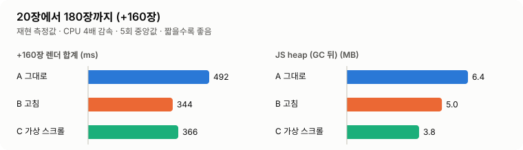

# jank-lab

**느린 화면을 재현하고, 재고, 고치는 실험실.**

실무에서 겪은 성능 문제를 회사 코드 없이 다시 만들고, 같은 조건에서 재고, 어떻게 고쳤는지와 무엇을 버렸는지를 숫자로 남깁니다. 사례마다 재현 앱, 측정 스크립트, 결과 JSON이 함께 있어 누구나 다시 돌려 볼 수 있습니다.

**데모**: [rowan-hyeho-song.github.io/jank-lab](https://rowan-hyeho-song.github.io/jank-lab/) · 사례 2는 [바로 열기](https://rowan-hyeho-song.github.io/jank-lab/case-2/)(`?v=a` · `b` · `c`로 변형을 바꿉니다)

| # | 사례 | 플랫폼 | 상태 |
|---|---|---|---|
| 1 | 상세 화면 전환이 끊기는 문제 (UI 스레드) | React Native | 준비 중 |
| 2 | [무한 스크롤 상품 목록이 길어질수록 느려지는 문제](#사례-2--무한-스크롤-상품-목록이-길어질수록-느려지는-문제) | Web · React | 완료 |

---

## 사례 2 · 무한 스크롤 상품 목록이 길어질수록 느려지는 문제

<picture>
  <source media="(prefers-color-scheme: dark)" srcset="cases/02-infinite-scroll/docs/case2-per-click-dark.svg">
  
</picture>

<picture>
  <source media="(prefers-color-scheme: dark)" srcset="cases/02-infinite-scroll/docs/case2-totals-dark.svg">
  
</picture>

그래프는 이 저장소의 **재현 측정값**입니다. 제품에서 잰 기록값은 [결과](#결과)에 따로 적었습니다.

### 문제

커머스 웹의 상품 목록은 "더 보기"를 누를 때마다 20장씩 길어지는 무한 스크롤이었습니다. 목록이 길어질수록 다음 20장을 붙이는 시간이 늘었고, 메모리도 함께 불었습니다. 오래 둘러본 사용자일수록 더 느린 화면을 보는 구조였습니다.

이 사례는 그 문제를 **회사 코드 없이 다시 만든 것**입니다. 상품 데이터는 시드로 만든 가짜이고, 카드 디자인도 새로 그렸습니다. 한 화면에서 세 변형을 바꿔 가며 볼 수 있습니다.


| 변형 | 무엇이 다른가 |
|---|---|
| **A 그대로** | 카드마다 `useMediaQuery`가 `matchMedia`를 새로 만들고, 더 보기마다 목록 전체가 다시 렌더됩니다. |
| **B 고침** | `React.memo`, 안정된 props, 공유 미디어쿼리 훅. 새로 붙은 20장만 렌더합니다. |
| **C 가상 스크롤** | B의 카드를 쓰되, 화면 근처 줄만 DOM에 둡니다(`@tanstack/react-virtual`). 비교용입니다. |

세 변형의 카드 마크업은 [같은 함수](cases/02-infinite-scroll/src/cardMarkup.tsx) 하나로 그립니다. 다른 것은 누가, 몇 번 그리느냐뿐입니다.

### 진단

제품에서 찾은 원인은 두 가지였습니다. **카드를 더 불러올 때마다 모든 카드가 다시 조정됐고, 카드마다 `matchMedia`를 만들었습니다.** 재현 앱(A)은 이 두 가지를 흔히 보이는 형태로 다시 만들었습니다.

1. **더 보기마다 모든 카드가 다시 렌더됩니다.** 목록 state가 바뀌면 부모가 다시 그려집니다. 카드에 `memo`가 없고 찜 핸들러를 카드마다 인라인 함수로 넘기므로, 이미 화면에 있던 카드까지 전부 다시 렌더됩니다. 그래서 목록 길이에 비례해 클릭 한 번이 무거워집니다.
2. **카드마다 `matchMedia`를 만듭니다.** 카드 안의 `useMediaQuery`가 렌더할 때마다 `matchMedia`로 새 `MediaQueryList`를 만듭니다. 그 객체가 effect의 의존성이라 렌더마다 구독을 풀고 다시 맺습니다. 카드 한 장이 세 가지를 물으므로, 1번과 겹치면 클릭 한 번에 수백 개가 생겼다 사라집니다.

재현 앱에서 세어 본 횟수는 다음과 같습니다(20장 → 180장, 더 보기 8번, 5회 중앙값).

| | 카드 렌더 | `matchMedia` 호출 | 리스너 다시 구독 |
|---|---:|---:|---:|
| A 그대로 | 1,280 | 3,840 | 2,640 |
| B 고침 | 160 | 0 | 0 |
| C 가상 스크롤 | 156 | 0 | 0 |

B와 C의 `matchMedia`는 페이지가 열릴 때 질문마다 한 번씩, 모두 세 번만 부릅니다(측정 구간 밖).

### 판단과 버린 대안

**고친 방법 (B)**

- 카드를 `React.memo`로 감쌌습니다.
- props를 안정시켰습니다.
  - 상품 객체는 페이지를 넘겨도 같은 참조를 유지합니다.
  - 찜 핸들러는 `useCallback` 하나로 두고, 카드가 자기 id로 부릅니다.
- [공유 미디어쿼리 훅](cases/02-infinite-scroll/src/useView.ts)을 만들었습니다.
  - 페이지 전체에서 질문마다 `MediaQueryList`를 하나만 만듭니다.
  - 모든 카드가 `useSyncExternalStore`로 같은 답을 읽습니다.
  - 카드는 화면이 실제로 경계를 넘을 때만 다시 그려집니다.

**가상 스크롤 (C)을 고르지 않은 이유**

숫자로는 C가 B를 크게 앞서지 않습니다. 기본 구간(+160장)에서 B는 344 ms, C는 366 ms(중앙값)이고, 다섯 회차의 범위도 B 329–415 ms, C 328–400 ms로 겹칩니다. 400장까지 늘리면 C가 빨라집니다(B 1,151 ms, C 902 ms). 이 차이는 React가 아니라 브라우저가 큰 DOM을 배치하는 비용입니다. 제품에서도 B로 고친 뒤 측정해 보니 가상 스크롤은 필요 없다고 판단했고, 넣지 않았습니다.

반면 가상 스크롤은 잃는 것이 분명합니다.

- **페이지 내 찾기**: 화면 밖 카드는 DOM에 없어서 브라우저의 찾기(Ctrl+F)로 찾을 수 없습니다.
- **스크롤 복원**: 상세 화면에 갔다가 뒤로 오면 브라우저 기본 복원이 맞지 않습니다. 높이를 추정하기 때문에 위치와 측정값을 따로 저장해야 합니다.
- **검색 노출·미리보기**: 크롤러나 정적 렌더가 보는 HTML에서 화면 밖 상품이 빠집니다.
- **접근성**: 스크린 리더가 목록 전체 길이를 알 수 없고, 탭 이동이 화면 밖 카드로 자연스럽게 이어지지 않습니다.
- **복잡도**: CSS 미디어쿼리만으로 끝나던 격자가, 줄 단위 가상화 때문에 열 수를 JS로 알아야 합니다. 카드 높이가 바뀌면 측정과 보정도 따라붙습니다.

다시 검토할 조건도 남겨 둡니다. 목록이 수천 장 단위로 길어지거나 카드 DOM이 훨씬 무거워지면 C를 다시 봅니다. C는 클릭 한 번의 시간이 목록 길이와 상관없이 40 ms대로 평평합니다.

### 결과

#### 재현 측정값 (이 저장소)

20장에서 시작해 더 보기를 8번 눌러 180장까지 늘렸습니다(+160장). 값은 5회 중앙값입니다.

| 변형 | +160장 렌더 합계 | JS heap (GC 뒤) | DOM 노드 |
|---|---:|---:|---:|
| A 그대로 | 492 ms | 6.4 MB | 6,165 |
| B 고침 | **344 ms** (−30%) | **5.0 MB** (−22%) | 6,165 |
| C 가상 스크롤 | 366 ms (−26%) | 3.8 MB (−40%) | 984 |

같은 조건으로 20번 눌러 420장까지 늘렸을 때(+400장)의 값입니다.

| 변형 | +400장 렌더 합계 | 마지막 클릭 | JS heap (GC 뒤) |
|---|---:|---:|---:|
| A 그대로 | 1,919 ms | 145 ms | 10.9 MB |
| B 고침 | 1,151 ms (−40%) | 73 ms | 7.5 MB (−31%) |
| C 가상 스크롤 | 902 ms (−53%) | 44 ms | 4.0 MB (−64%) |

측정 조건:

- 운영 빌드(`vite build`)
- Google Chrome 157 headless
- 1280 × 800, DPR 1
- 페이지가 열린 뒤 **CPU 4배 감속**(`Emulation.setCPUThrottlingRate`)
- 회차마다 새 브라우저 컨텍스트
- 변형을 A B C 순서로 번갈아 측정
- 측정한 컴퓨터: AMD Ryzen 7 9800X3D, Windows

절대값은 컴퓨터마다 다릅니다. 원본 값은 [`results/case2.json`](cases/02-infinite-scroll/results/case2.json)과 [`results/case2-long.json`](cases/02-infinite-scroll/results/case2-long.json)에 있습니다. 회차별 값과 클릭마다의 값도 들어 있습니다.

재현 카드는 제품 카드보다 가볍습니다. 실제 이미지가 없고, 카드 한 장이 DOM 노드 약 34개입니다. 그래서 개선 폭이 제품보다 작게 나옵니다. 방향과 원인은 같습니다.

#### 제품에서 잰 기록값

실제 서비스에서 잰 값입니다. 측정 환경이 위와 다르므로, 위 재현 측정값과 섞어 비교하지 않습니다.

| | 고치기 전 | 고친 뒤 |
|---|---:|---:|
| 160장 추가 렌더 | 2,193 ms | **453 ms** (−79%) |
| JS heap | 169 MB | **65 MB** (−62%) |

### 직접 돌려 보기

Node 20.19 이상, pnpm 10, Google Chrome이 필요합니다. Chrome이 없으면 `pnpm --filter ./cases/02-infinite-scroll exec playwright-core install chromium`으로 Chromium을 받습니다.

```sh
pnpm install
pnpm dev            # 재현 앱: http://localhost:5392/?v=a (b, c)
pnpm measure        # 빌드 → 변형마다 5회 측정 → results/case2.json → 그래프
pnpm measure:long   # +400장 곡선 → results/case2-long.json → 그래프
```

`RUNS=9 CPU=6 pnpm measure`처럼 회차와 감속 배수를 바꿀 수 있습니다.

**어떻게 재나**

- **클릭 → 다음 페인트**는 페이지 안에서 잽니다([`probe.ts`](cases/02-infinite-scroll/src/probe.ts)).
  - 시작은 클릭 이벤트의 `timeStamp`입니다.
  - 그 뒤 `requestAnimationFrame` 콜백에서 `MessageChannel`로 메시지를 보냅니다.
  - 메시지가 도착한 시각, 곧 결과가 그려진 직후가 끝입니다.
- **JS heap**은 `HeapProfiler.collectGarbage`를 두 번 부른 뒤 `Performance.getMetrics`의 `JSHeapUsedSize`로 읽습니다.
- **렌더 횟수**는 카드와 훅 안의 단순 카운터로 셉니다([`counts.ts`](cases/02-infinite-scroll/src/counts.ts)).
- 측정 스크립트는 [`scripts/measure.mjs`](cases/02-infinite-scroll/scripts/measure.mjs)이고, 그래프는 [`scripts/chart.mjs`](cases/02-infinite-scroll/scripts/chart.mjs)가 JSON에서 라이트·다크 SVG로 만듭니다.

**코드 지도**

| 파일 | 내용 |
|---|---|
| [`src/variants/A.tsx`](cases/02-infinite-scroll/src/variants/A.tsx) | 그대로: memo 없음, 인라인 핸들러, 카드별 미디어쿼리 |
| [`src/useMediaQueryPerCard.ts`](cases/02-infinite-scroll/src/useMediaQueryPerCard.ts) | A의 훅: 렌더마다 `matchMedia`, 렌더마다 다시 구독 |
| [`src/variants/B.tsx`](cases/02-infinite-scroll/src/variants/B.tsx) | 고침: `memo`, `useCallback`, 공유 훅 |
| [`src/useView.ts`](cases/02-infinite-scroll/src/useView.ts) | 공유 미디어쿼리 훅(`useSyncExternalStore`) |
| [`src/variants/C.tsx`](cases/02-infinite-scroll/src/variants/C.tsx) | 가상 스크롤(줄 단위, 창 스크롤) |

---

## 라이선스

[MIT](LICENSE)
