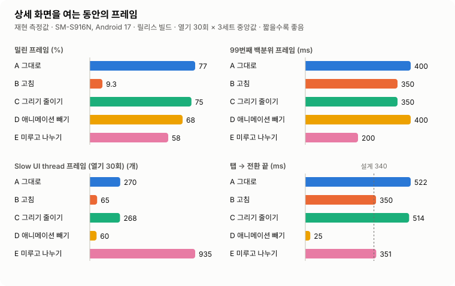
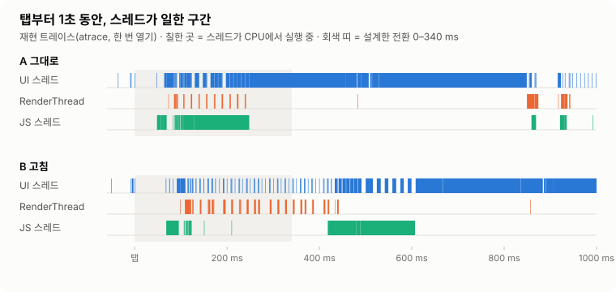
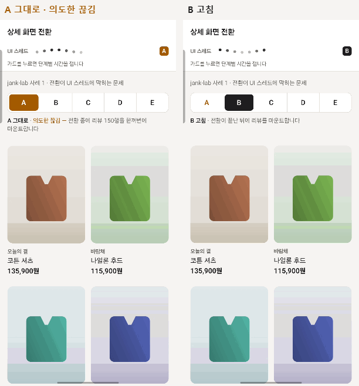
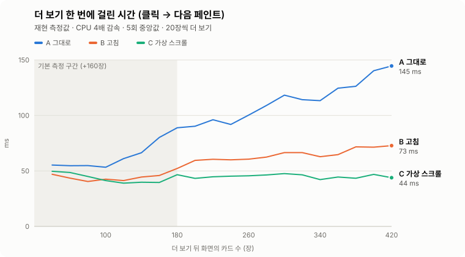
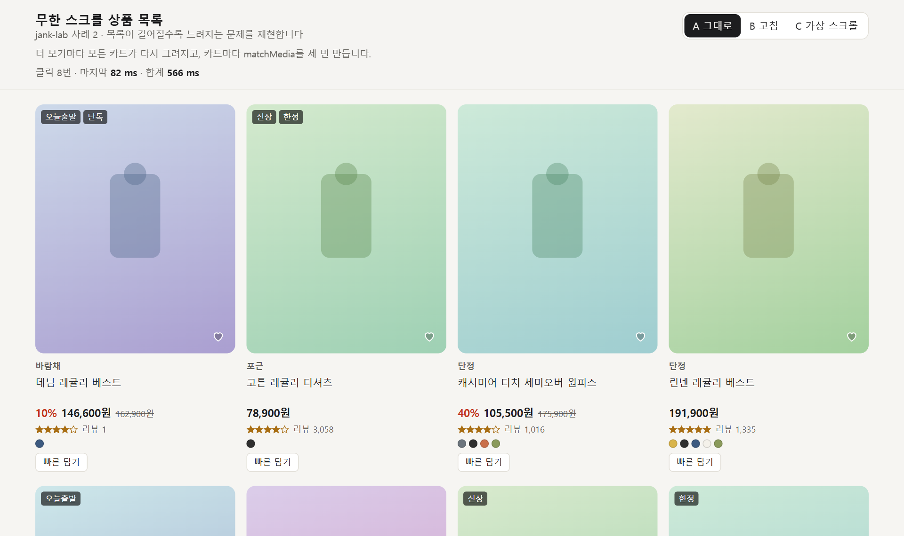

# jank-lab

**느린 화면을 재현하고, 재고, 고치는 실험실.**

실무에서 겪은 성능 문제를 회사 코드 없이 다시 만들고, 같은 조건에서 재고, 어떻게 고쳤는지와 무엇을 버렸는지를 숫자로 남깁니다. 사례마다 재현 앱, 측정 스크립트, 결과 JSON이 함께 있어 누구나 다시 돌려 볼 수 있습니다.

**데모**: [rowan-hyeho-song.github.io/jank-lab](https://rowan-hyeho-song.github.io/jank-lab/) · 사례 2는 [바로 열기](https://rowan-hyeho-song.github.io/jank-lab/case-2/)(`?v=a` · `b` · `c`로 변형을 바꿉니다) · 사례 1은 Android 앱이라 [녹화](#사례-1--상세-화면-전환이-끊기는-문제)로 봅니다

| # | 사례 | 플랫폼 | 상태 |
|---|---|---|---|
| 1 | [상세 화면 전환이 끊기는 문제 (UI thread)](#사례-1--상세-화면-전환이-끊기는-문제) | React Native · Android | 완료 |
| 2 | [무한 스크롤 상품 목록이 길어질수록 느려지는 문제](#사례-2--무한-스크롤-상품-목록이-길어질수록-느려지는-문제) | Web · React | 완료 |

---

## 사례 1 · 상세 화면 전환이 끊기는 문제

<picture>
  <source media="(prefers-color-scheme: dark)" srcset="cases/01-detail-transition/docs/case1-frames-dark.svg">
  
</picture>

<picture>
  <source media="(prefers-color-scheme: dark)" srcset="cases/01-detail-transition/docs/case1-trace-dark.svg">
  
</picture>

**전환 중 밀린 frame 77% → 9%, 전환 시간 522 → 350 ms(설계 340 ms대로), Slow UI thread 270 → 65.** GPU는 A · B 모두 p99 10 ms 안이라 원인이 아니었습니다.

그래프는 이 저장소의 **재현 측정값**입니다. 제품에서 잰 기록값은 [결과](#결과)에 따로 적었습니다.

### 문제

커머스 앱에서 목록의 상품 사진이 그대로 커져 상세 화면의 큰 사진(hero)으로 이어지는 transition을 340 ms로 설계했습니다. 실제로 재 보니 620~800 ms가 걸렸고, 중간에 멈칫했습니다.

이 사례는 **같은 원인을 회사 코드 없이 재현한 실험**입니다. 제품에서 구체적으로 무엇을 미뤘는지는 기록에 없어, 여기서는 "transition이 진행되는 동안 상세 화면의 무거운 트리를 mount한다"는 원인만 다시 만들었습니다. 상품과 리뷰는 시드로 만든 가짜 데이터이고, 화면 디자인도 새로 그렸습니다.



왼쪽이 A, 오른쪽이 B입니다. 맨 위 계기판의 점 일곱 개는 native driver로 도는 파도라서 UI thread가 막히면 함께 멈춥니다.
- A는 사진이 hero 자리로 가다 멈추고, 그동안 점도 한 모양으로 굳습니다.
- B는 transition 내내 점이 흐르고, 끝난 뒤 리뷰를 mount할 때 잠깐 굳습니다.
- 계기판 둘째 줄은 탭부터 "전환 끝"과 "리뷰 표시"까지 걸린 시간입니다.

| 변형 | 무엇이 다른가 |
|---|---|
| **A 그대로** | transition이 진행되는 동안 리뷰 150행(사진 · 테두리 · 둥근 모서리)을 한꺼번에 mount합니다. 의도한 끊김입니다. |
| **B 고침** | transition 중에는 가벼운 placeholder만 그리고, transition이 끝난 다음 frame에 리뷰를 mount합니다. |
| **C 그리기 줄이기** | A에서 테두리 · 둥근 모서리 · 사진을 빼고 `memo`로 감쌉니다. native view 수는 A와 같습니다. 버린 대안입니다. |
| **D 애니메이션 빼기** | A에서 transition animation만 끕니다. 버린 대안입니다. |
| **E 미루고 나누기** | B처럼 transition 뒤로 미루고, 리뷰를 한 frame에 5행씩 나눠 mount합니다. **이 재현에서 한 걸음 더 가 본 것**이고, 제품 기록에는 없습니다. |

### 진단: 무엇이 느린지부터 가르기

먼저 "그리는 일(GPU)이 무거운가, thread가 막혀 있는가"를 갈랐습니다.

1. **`dumpsys gfxinfo`**: A는 열기 30회 동안 frame 358개 중 77.4%(약 277개)가 밀렸습니다.
   - Slow UI thread로 분류된 frame이 270개로, 밀린 frame과 거의 같습니다. gfxinfo는 원인 분류를 따로 세서 한 frame이 여러 분류에 들어갈 수 있습니다.
   - GPU는 중앙값 3 ms, 99번째 백분위도 10 ms였습니다. 그리는 일은 frame 예산 안에 있었습니다.
2. **trace(atrace, 이 앱의 thread만)**: A는 탭 뒤 500 ms 동안 UI thread가 390 ms를 실행했고, RenderThread는 29 ms만 실행했습니다. 가장 긴 frame은 615 ms였습니다.
3. **원인**: New Architecture(Fabric)는 native view를 UI thread에서 만들고 배치합니다. 사진이 커지는 transition도 native driver라서 같은 UI thread가 그립니다. 리뷰 150행을 mount하는 동안 UI thread가 animation frame을 만들지 못해, transition이 멈췄다가 끝 상태로 건너뜁니다.

그래서 문제는 그리기 성능이 아니라 **UI thread를 누가 언제 차지하느냐**였습니다.

### 판단과 버린 대안

**고친 방법 (B)**: 무거운 mount를 transition이 끝난 뒤로 미뤘습니다. transition 동안에는 placeholder 세 칸만 그립니다.
- 밀린 frame이 77.4%에서 9.3%로, Slow UI thread가 270에서 65로 줄었습니다.
- 탭에서 transition 끝까지가 522 ms에서 350 ms가 되어 설계(340 ms)대로 돌아왔습니다.
- trace에서도 transition 동안 RenderThread가 frame을 계속 그립니다(탭 뒤 500 ms에 80 ms 실행).

**p99가 조금만 줄어든 이유**: p99는 400 ms에서 350 ms로만 줄었습니다. B에서는 transition이 끝난 뒤 리뷰 150행을 mount하는 긴 frame이 열 때마다 하나씩 남고, 이것이 p99를 차지합니다. 계기판에서 transition 직후 점이 굳는 구간이 이 frame입니다. **비용이 사라진 것이 아니라 transition 밖으로 옮겨 간 것**입니다. 사용자가 보는 transition은 지켰지만 UI thread가 한 번 막히는 일은 남아 있습니다.

**그리기 줄이기 (C)를 버린 이유**: GPU가 놀고 있었으니 원인과 맞지 않았습니다. 테두리 · 둥근 모서리 · 사진을 빼고 `memo`까지 씌워도 밀린 frame은 74.7%, Slow UI thread는 268, transition 끝은 514 ms로 A와 거의 같았습니다. native view 수가 그대로라 UI thread가 하는 일이 줄지 않습니다.

**애니메이션 빼기 (D)를 버린 이유**: 그릴 animation frame이 없으니 Slow UI thread는 60으로 줄지만, 밀린 frame은 여전히 68.2%입니다. 남은 frame이 대부분 mount frame이기 때문입니다. 화면은 mount가 끝날 때까지 멈춰 있고, 연결 transition이라는 경험 자체가 없어집니다. 원인은 건드리지 못하고 증상을 가린 것입니다.

**한 걸음 더 (E)**: B 다음의 질문은 "남은 긴 frame 하나를 어떻게 하나"입니다. 리뷰를 한 frame에 5행씩 나눠 mount하면 긴 frame이 줄어듭니다(p99 200 ms). 대신 나눠 그린 frame도 하나하나 예산을 넘어서 밀린 frame이 57.6%이고, 리뷰가 다 보이기까지 2.7 s가 걸립니다. 나눠 그리기에도 대가가 있다는 trade-off입니다. 다음 단계는 한 번에 mount하는 양을 더 줄이거나, 화면에 보이는 만큼만 mount하는 것(virtualized list)입니다. 기록에는 "미뤘다"만 있으므로 E는 제품과 대응하지 않습니다.

### 결과

#### 재현 측정값 (열기 구간)

탭부터 상세 화면이 자리 잡을 때까지(3.2 s)의 frame입니다. 변형마다 30회씩 3세트를 돌린 중앙값입니다.

| 변형 | 밀린 frame | p50 | p90 | p99 | Slow UI thread | GPU p50 / p99 | 탭 → 전환 끝 | 탭 → 리뷰 표시 |
|---|---:|---:|---:|---:|---:|---:|---:|---:|
| A 그대로 | 77.4% | 12 ms | 250 ms | 400 ms | 270 | 3 / 10 ms | 522 ms | 184 ms |
| **B 고침** | **9.3%** | **5 ms** | **9 ms** | 350 ms | **65** | 2 / 9 ms | **350 ms** | 523 ms |
| C 그리기 줄이기 | 74.7% | 12 ms | 200 ms | 350 ms | 268 | 3 / 10 ms | 514 ms | 184 ms |
| D 애니메이션 빼기 | 68.2% | 19 ms | 350 ms | 400 ms | 60 | 6 / 15 ms | (animation 없음) | 195 ms |
| E 미루고 나누기 | 57.6% | 27 ms | 105 ms | **200 ms** | 935 | 2 / 10 ms | 351 ms | 2,701 ms |

- A의 "리뷰 표시"가 "전환 끝"보다 이른 것은, 리뷰가 transition 도중에 배치(onLayout)되기 때문입니다. 그 mount가 transition을 멈춥니다.
- 열기와 닫기를 합친 값, 세트별 값, frame 수는 [`results/case1.json`](cases/01-detail-transition/results/case1.json)에 있습니다. trace 구간은 [`results/case1-trace.json`](cases/01-detail-transition/results/case1-trace.json)에 있습니다.

#### 제품에서 잰 기록값

실제 서비스에서 잰 값입니다. 기록에는 이 값이 어느 구간(열기만, 열고 닫기, 화면 전체)인지 적혀 있지 않습니다. 재현의 열기 구간과 재는 구간이 다를 수 있어서 위 재현 측정값과 섞어 비교하지 않습니다. 기록의 "고친 뒤"는 재현의 B(미루기)에 해당합니다.

| | 고치기 전 | 고친 뒤 |
|---|---:|---:|
| 상세 transition (설계 340 ms) | 620~800 ms | — |
| p99 frame | 400 ms | **22 ms** |
| 밀린 frame | 22.69% | **6.03%** |
| 놓친 Vsync | 26 | **0** |

고치기 전 밀린 frame 179개 중 171개가 Slow UI thread였고, GPU는 2~3 ms였습니다.

### 측정 조건

- **기기**: Galaxy S23+(SM-S916N), Android 17, 120 Hz 화면(이 앱의 frame은 대부분 16.7 ms 간격)
- **빌드**: release APK, Hermes, New Architecture(Fabric), arm64-v8a. 측정 빌드 = 최종 앱(계기판 포함, `meter=off`)
- **반복**: 변형마다 열기 · 닫기 30회 × 3세트, A B C D E를 번갈아 돌림
- **지표**: 매 회 열고 3.2 s 뒤 `dumpsys gfxinfo <pkg> reset`(열기 구간), 닫고 1.4 s 뒤 다시 reset(닫기 구간). 세트마다 열기 구간을 더해 histogram에서 백분위를 구하고, 변형마다 세트의 중앙값을 씁니다. 3.2 s는 E가 리뷰를 다 그리는 시간(약 2.7 s)보다 깁니다.
- **닫기**: 화면의 뒤로 단추를 탭합니다. 키 이벤트로 닫으면 쉬던 화면이 낮은 주사율에 머물러 첫 frame이 늦게 와서 측정을 흐립니다.
- **안전장치**: 탭하기 직전마다 맨 앞 activity가 이 앱인지 확인하고, 아니면 아무것도 누르지 않고 멈춥니다. 긴 측정 도중 다른 앱의 팝업이 뜰 수 있어서입니다.
- **리뷰 150행**: 300행은 S23+에서도 한 frame이 약 1초라 기록과 너무 멀어 줄였습니다.
- **계기판 끔**: 파도가 돌면 frame이 계속 그려져 gfxinfo 분모가 바뀝니다. 그래서 측정과 trace는 `?meter=off`로 띄웁니다. 배치는 켤 때와 같습니다.
- **transition**: 340 ms, `Easing.out(Easing.poly(4))`, native driver. 열 때와 닫을 때 모두 같은 연결 transition입니다(D만 없음).

### 직접 돌려 보기

Node 22 이상, JDK 17, Android SDK(platform 36, NDK 27.1), adb로 연결된 Android 기기(USB나 무선 디버깅)가 필요합니다. 측정하는 동안 화면을 켜고 잠금을 풀어 두세요.

```sh
cd cases/01-detail-transition
npm ci
npm run measure   # release build → 설치 → A~E × 3세트 × 30회 → 앱 삭제 → results/case1.json → 그래프
npm run trace     # 앱이 설치된 상태에서 A · B를 한 번씩 trace → results/case1-trace.json
```

- 루트에서는 `pnpm measure:case1`로도 돌립니다.
- `SETS=5 CYCLES=30 VARIANTS=a,b npm run measure`처럼 바꿀 수 있습니다. 기기가 여럿이면 `ANDROID_SERIAL`을 지정합니다.
- `node scripts/measure.mjs --keep`이면 측정 뒤 앱을 지우지 않습니다(trace용).
- **Windows**: native build가 경로 260자 제한에 걸릴 수 있습니다. 그래서 이 앱은 C++ codegen 경로가 긴 navigation 라이브러리 없이 RN 기본 `Animated`로 화면 둘과 transition을 만들었습니다. 저장소를 짧은 경로에 두면 안전합니다.
- trace의 atrace 원본에는 기기의 다른 프로세스도 들어 있습니다. 스크립트는 이 앱의 thread 구간만 남깁니다.

**코드 지도**

| 파일 | 내용 |
|---|---|
| [`App.tsx`](cases/01-detail-transition/App.tsx) | 목록 ↔ 상세 연결 transition(시계 하나, native driver), 변형 D |
| [`src/DetailScreen.tsx`](cases/01-detail-transition/src/DetailScreen.tsx) | 리뷰를 언제 mount하는가: A · C 바로, B · E transition 뒤, E 5행씩 |
| [`src/Rows.tsx`](cases/01-detail-transition/src/Rows.tsx) | 리뷰 행(A · B · D · E)과 그리기를 줄인 행(C) |
| [`src/Top.tsx`](cases/01-detail-transition/src/Top.tsx) | 위 바와 계기판(UI thread 파도, 단계별 시간) |
| [`scripts/measure.mjs`](cases/01-detail-transition/scripts/measure.mjs) | adb · gfxinfo 측정, 탭 전 맨 앞 activity 확인 |
| [`scripts/trace.mjs`](cases/01-detail-transition/scripts/trace.mjs) | atrace에서 이 앱의 thread 구간만 추림 |

---

## 사례 2 · 무한 스크롤 상품 목록이 길어질수록 느려지는 문제

<picture>
  <source media="(prefers-color-scheme: dark)" srcset="cases/02-infinite-scroll/docs/case2-per-click-dark.svg">
  
</picture>

<picture>
  <source media="(prefers-color-scheme: dark)" srcset="cases/02-infinite-scroll/docs/case2-totals-dark.svg">
  
</picture>

그래프는 이 저장소의 **재현 측정값**입니다. 제품에서 잰 기록값은 [결과](#결과-1)에 따로 적었습니다.

### 문제

커머스 웹의 상품 목록은 "더 보기"를 누를 때마다 20장씩 길어지는 무한 스크롤이었습니다. 목록이 길어질수록 다음 20장을 붙이는 시간이 늘었고, 메모리도 함께 불었습니다. 오래 둘러본 사용자일수록 더 느린 화면을 보는 구조였습니다.

이 사례는 그 문제를 **회사 코드 없이 다시 만든 것**입니다. 상품 데이터는 시드로 만든 가짜이고, 카드 디자인도 새로 그렸습니다. 한 화면에서 세 변형을 바꿔 가며 볼 수 있습니다.



| 변형 | 무엇이 다른가 |
|---|---|
| **A 그대로** | 카드마다 `useMediaQuery`가 `matchMedia`를 새로 만들고, 더 보기마다 목록 전체가 다시 렌더됩니다. |
| **B 고침** | `React.memo`, 안정된 props, 공유 미디어쿼리 훅. 새로 붙은 20장만 렌더합니다. |
| **C 가상 스크롤** | B의 카드를 쓰되, 화면 근처 줄만 DOM에 둡니다(`@tanstack/react-virtual`). 비교용입니다. |

세 변형의 카드 마크업은 [같은 함수](cases/02-infinite-scroll/src/cardMarkup.tsx) 하나로 그립니다. 다른 것은 누가, 몇 번 그리느냐뿐입니다.

### 진단

제품에서 찾은 원인은 두 가지였습니다. **카드를 더 불러올 때마다 모든 카드가 다시 조정됐고, 카드마다 `matchMedia`를 만들었습니다.** 재현 앱(A)은 이 두 가지를 흔히 보이는 형태로 다시 만들었습니다.

1. **더 보기마다 모든 카드가 다시 렌더됩니다.** 목록 state가 바뀌면 부모가 다시 그려집니다. 카드에 `memo`가 없고 찜 핸들러를 카드마다 인라인 함수로 넘기므로, 이미 화면에 있던 카드까지 전부 다시 렌더됩니다. 그래서 목록 길이에 비례해 클릭 한 번이 무거워집니다.
2. **카드마다 `matchMedia`를 만듭니다.** 카드 안의 `useMediaQuery`가 렌더할 때마다 `matchMedia`로 새 `MediaQueryList`를 만듭니다. 그 객체가 effect의 의존성이라 렌더마다 구독을 풀고 다시 맺습니다. 카드 한 장이 세 가지를 물으므로, 1번과 겹치면 클릭 한 번에 수백 개가 생겼다 사라집니다.

재현 앱에서 세어 본 횟수는 다음과 같습니다(20장 → 180장, 더 보기 8번, 5회 중앙값).

| | 카드 렌더 | `matchMedia` 호출 | 리스너 다시 구독 |
|---|---:|---:|---:|
| A 그대로 | 1,280 | 3,840 | 2,640 |
| B 고침 | 160 | 0 | 0 |
| C 가상 스크롤 | 156 | 0 | 0 |

B와 C의 `matchMedia`는 페이지가 열릴 때 질문마다 한 번씩, 모두 세 번만 부릅니다(측정 구간 밖).

### 판단과 버린 대안

**고친 방법 (B)**

- 카드를 `React.memo`로 감쌌습니다.
- props를 안정시켰습니다.
  - 상품 객체는 페이지를 넘겨도 같은 참조를 유지합니다.
  - 찜 핸들러는 `useCallback` 하나로 두고, 카드가 자기 id로 부릅니다.
- [공유 미디어쿼리 훅](cases/02-infinite-scroll/src/useView.ts)을 만들었습니다.
  - 페이지 전체에서 질문마다 `MediaQueryList`를 하나만 만듭니다.
  - 모든 카드가 `useSyncExternalStore`로 같은 답을 읽습니다.
  - 카드는 화면이 실제로 경계를 넘을 때만 다시 그려집니다.

**가상 스크롤 (C)을 고르지 않은 이유**

숫자로는 C가 B를 크게 앞서지 않습니다. 기본 구간(+160장)에서 B는 344 ms, C는 366 ms(중앙값)이고, 다섯 회차의 범위도 B 329–415 ms, C 328–400 ms로 겹칩니다. 400장까지 늘리면 C가 빨라집니다(B 1,151 ms, C 902 ms). 이 차이는 React가 아니라 브라우저가 큰 DOM을 배치하는 비용입니다. 제품에서도 B로 고친 뒤 측정해 보니 가상 스크롤은 필요 없다고 판단했고, 넣지 않았습니다.

반면 가상 스크롤은 잃는 것이 분명합니다.

- **페이지 내 찾기**: 화면 밖 카드는 DOM에 없어서 브라우저의 찾기(Ctrl+F)로 찾을 수 없습니다.
- **스크롤 복원**: 상세 화면에 갔다가 뒤로 오면 브라우저 기본 복원이 맞지 않습니다. 높이를 추정하기 때문에 위치와 측정값을 따로 저장해야 합니다.
- **검색 노출·미리보기**: 크롤러나 정적 렌더가 보는 HTML에서 화면 밖 상품이 빠집니다.
- **접근성**: 스크린 리더가 목록 전체 길이를 알 수 없고, 탭 이동이 화면 밖 카드로 자연스럽게 이어지지 않습니다.
- **복잡도**: CSS 미디어쿼리만으로 끝나던 격자가, 줄 단위 가상화 때문에 열 수를 JS로 알아야 합니다. 카드 높이가 바뀌면 측정과 보정도 따라붙습니다.

다시 검토할 조건도 남겨 둡니다. 목록이 수천 장 단위로 길어지거나 카드 DOM이 훨씬 무거워지면 C를 다시 봅니다. C는 클릭 한 번의 시간이 목록 길이와 상관없이 40 ms대로 평평합니다.

### 결과

#### 재현 측정값 (이 저장소)

20장에서 시작해 더 보기를 8번 눌러 180장까지 늘렸습니다(+160장). 값은 5회 중앙값입니다.

| 변형 | +160장 렌더 합계 | JS heap (GC 뒤) | DOM 노드 |
|---|---:|---:|---:|
| A 그대로 | 492 ms | 6.4 MB | 6,165 |
| B 고침 | **344 ms** (−30%) | **5.0 MB** (−22%) | 6,165 |
| C 가상 스크롤 | 366 ms (−26%) | 3.8 MB (−40%) | 984 |

같은 조건으로 20번 눌러 420장까지 늘렸을 때(+400장)의 값입니다.

| 변형 | +400장 렌더 합계 | 마지막 클릭 | JS heap (GC 뒤) |
|---|---:|---:|---:|
| A 그대로 | 1,919 ms | 145 ms | 10.9 MB |
| B 고침 | 1,151 ms (−40%) | 73 ms | 7.5 MB (−31%) |
| C 가상 스크롤 | 902 ms (−53%) | 44 ms | 4.0 MB (−64%) |

측정 조건:

- 운영 빌드(`vite build`)
- Google Chrome 157 headless
- 1280 × 800, DPR 1
- 페이지가 열린 뒤 **CPU 4배 감속**(`Emulation.setCPUThrottlingRate`)
- 회차마다 새 브라우저 컨텍스트
- 변형을 A B C 순서로 번갈아 측정
- 측정한 컴퓨터: AMD Ryzen 7 9800X3D, Windows

절대값은 컴퓨터마다 다릅니다. 원본 값은 [`results/case2.json`](cases/02-infinite-scroll/results/case2.json)과 [`results/case2-long.json`](cases/02-infinite-scroll/results/case2-long.json)에 있습니다. 회차별 값과 클릭마다의 값도 들어 있습니다.

재현 카드는 제품 카드보다 가볍습니다. 실제 이미지가 없고, 카드 한 장이 DOM 노드 약 34개입니다. 그래서 개선 폭이 제품보다 작게 나옵니다. 방향과 원인은 같습니다.

#### 제품에서 잰 기록값

실제 서비스에서 잰 값입니다. 측정 환경이 위와 다르므로, 위 재현 측정값과 섞어 비교하지 않습니다.

| | 고치기 전 | 고친 뒤 |
|---|---:|---:|
| 160장 추가 렌더 | 2,193 ms | **453 ms** (−79%) |
| JS heap | 169 MB | **65 MB** (−62%) |

### 직접 돌려 보기

Node 20.19 이상, pnpm 10, Google Chrome이 필요합니다. Chrome이 없으면 `pnpm --filter ./cases/02-infinite-scroll exec playwright-core install chromium`으로 Chromium을 받습니다.

```sh
pnpm install
pnpm dev            # 재현 앱: http://localhost:5392/?v=a (b, c)
pnpm measure        # 빌드 → 변형마다 5회 측정 → results/case2.json → 그래프
pnpm measure:long   # +400장 곡선 → results/case2-long.json → 그래프
```

`RUNS=9 CPU=6 pnpm measure`처럼 회차와 감속 배수를 바꿀 수 있습니다.

**어떻게 재나**

- **클릭 → 다음 페인트**는 페이지 안에서 잽니다([`probe.ts`](cases/02-infinite-scroll/src/probe.ts)).
  - 시작은 클릭 이벤트의 `timeStamp`입니다.
  - 그 뒤 `requestAnimationFrame` 콜백에서 `MessageChannel`로 메시지를 보냅니다.
  - 메시지가 도착한 시각, 곧 결과가 그려진 직후가 끝입니다.
- **JS heap**은 `HeapProfiler.collectGarbage`를 두 번 부른 뒤 `Performance.getMetrics`의 `JSHeapUsedSize`로 읽습니다.
- **렌더 횟수**는 카드와 훅 안의 단순 카운터로 셉니다([`counts.ts`](cases/02-infinite-scroll/src/counts.ts)).
- 측정 스크립트는 [`scripts/measure.mjs`](cases/02-infinite-scroll/scripts/measure.mjs)이고, 그래프는 [`scripts/chart.mjs`](cases/02-infinite-scroll/scripts/chart.mjs)가 JSON에서 라이트·다크 SVG로 만듭니다.

**코드 지도**

| 파일 | 내용 |
|---|---|
| [`src/variants/A.tsx`](cases/02-infinite-scroll/src/variants/A.tsx) | 그대로: memo 없음, 인라인 핸들러, 카드별 미디어쿼리 |
| [`src/useMediaQueryPerCard.ts`](cases/02-infinite-scroll/src/useMediaQueryPerCard.ts) | A의 훅: 렌더마다 `matchMedia`, 렌더마다 다시 구독 |
| [`src/variants/B.tsx`](cases/02-infinite-scroll/src/variants/B.tsx) | 고침: `memo`, `useCallback`, 공유 훅 |
| [`src/useView.ts`](cases/02-infinite-scroll/src/useView.ts) | 공유 미디어쿼리 훅(`useSyncExternalStore`) |
| [`src/variants/C.tsx`](cases/02-infinite-scroll/src/variants/C.tsx) | 가상 스크롤(줄 단위, 창 스크롤) |

---

## 라이선스

[MIT](LICENSE)
